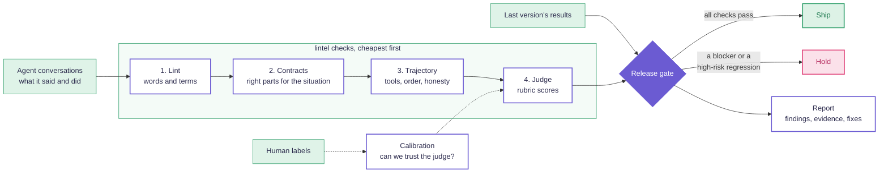
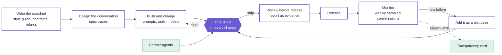

<p align="center">
  
</p>

<p align="center">
  <a href="https://github.com/jkelleman/lintel/actions/workflows/evals.yml"></a>
  
  
  
  
  <a href="LICENSE"></a>
</p>

# lintel

lintel is a friendly second reader for AI agents in professional design software. It checks each agent reply in four steps, from word choice up to the actions the agent took, and then tells you whether a new agent version is ready to ship.

Content designers write the rules in YAML files. Engineers run lintel in CI.

> Inspired by the Autodesk content design leadership. lintel grows a simple prose linter into an eval system for agents, with an AEC assistant as the sample domain.

<p align="center">
  <a href="https://jkelleman.github.io/lintel/demo.html"></a>
</p>

<p align="center">The demo runs 30 seconds. To pause it or jump to a step, <a href="https://jkelleman.github.io/lintel/demo.html">watch the video version</a>.</p>

## Explain it like I'm five

Picture a new assistant at an architecture firm who answers clients' questions and does small jobs in their drawings. Before that assistant works alone, someone should check their work. Do they use the firm's words? Do they ask before throwing anything away? When a job half-fails, do they say so?

lintel is that checker for AI assistants. It reads what the AI said and what it did, marks the problems the way an editor marks up a draft, and tells you whether the assistant is ready for real customers.

**Want the full picture?** [Read the explainer](docs/EXPLAINED.md): what lintel is, why evals are becoming standard practice across AI labs, analysts and standards bodies (with sources), and how lintel could fit into Autodesk's AI workflow.

## What the sample run shows

The sample compares two versions of a fictional assistant across 12 AEC scenarios.

- The baseline passes 2 of 12 cases. The candidate passes 11 of 12.
- The gate still holds the candidate. On a partial PDF export, it tells the user "Done!" even though two sheets failed.
- An average score would have shipped that version. lintel gates each high-risk case on its own, so one serious regression is enough to hold the release.

[Open the sample report](https://jkelleman.github.io/lintel/sample-report.html) · [Read the case study](docs/CASE_STUDY.md) · [See how this connects to Autodesk's AI work](docs/WHY_AUTODESK.md)

## How it works

lintel runs four levels of checks, cheapest first:

1. **Lint** checks word choice, terminology and reading level.
2. **Contracts** check that a reply has the right parts for the situation, such as after an error.
3. **Trajectory** checks what the agent did: which tools it called, in what order, and what it reported.
4. **Judge** scores grounding, usefulness and voice against a rubric.

Then **calibration** checks how closely the judge agrees with human reviewers.



<details>
<summary><b>See what each level checks, where its rules live and what it costs</b></summary>

| Level | What it checks | Where the rules live | Cost | Example finding |
|---|---|---|---|---|
| **1. Lint** | Word choice, terminology, length, reading level, voice | [`config/styleguide.yaml`](config/styleguide.yaml) | Free and instant | "fully compliant" is a blocker: only the code official can say that |
| **2. Contracts** | The shape a reply must take in a given situation | [`config/contracts.yaml`](config/contracts.yaml) | Free | After a tool error, the reply must say what happened, why, what's safe, and what to do next |
| **3. Trajectory** | What the agent did: which tools it called, in what order, and what it reported | [`lintel/trajectory.py`](lintel/trajectory.py) and each case's `expect` block | Free | The agent ran `purge_unused` before the user said yes |
| **4. Judge** | Grounding, usefulness and voice, scored against a rubric | [`rubrics/`](rubrics) | One model call per criterion | The reply says 16 clashes; the tool returned 14 |
| **Calibration** | How closely the judge agrees with human reviewers | [`labels/human_labels.jsonl`](labels/human_labels.jsonl) | Reviewer time | Agreement is 88% but κ is 0.59, so this criterion can't gate a release yet |

</details>

## Where it fits in your workflow

lintel runs in CI on every change to prompts, tools or models. It also connects the steps before and after: content designers write the standard, designers write the ideal conversations, reviewers read the report before release, and failures found in production become new test cases.



See [how this could work at Autodesk](docs/EXPLAINED.md#5-how-lintel-fits-autodesks-ai-workflow), stage by stage, with a 90-day pilot plan.

## Use cases

lintel covers 16 use cases in four groups. Open a group to see its use cases, or read [all of them in detail](docs/USE_CASES.md).

<details>
<summary><b>Shipping agent changes safely</b> (4): prompt changes, model swaps, incidents, partner agents</summary>

| Use case | Who it helps | What lintel checks | Status |
|---|---|---|---|
| [Gate a prompt change](docs/USE_CASES.md#1-gate-a-prompt-or-system-prompt-change) | PMs, engineers, content designers | Every case against the last version, with a ship or hold decision | Ready now |
| [Compare models](docs/USE_CASES.md#2-compare-models-before-switching-or-routing) | Platform engineers, AI PMs | Voice, honesty and safety per model, broken down by tag | Ready now |
| [Turn an incident into a test](docs/USE_CASES.md#3-turn-an-incident-into-a-permanent-test) | Incident owners | That a past failure never comes back | Ready now |
| [Review a partner agent](docs/USE_CASES.md#4-review-a-partner-or-third-party-agent) | Platform and partner teams | Third-party agents against your own standards | Needs setup |

</details>
<details>
<summary><b>Words and voice</b> (4): style guides, UI strings, localization, onboarding</summary>

| Use case | Who it helps | What lintel checks | Status |
|---|---|---|---|
| [Run your style guide as rules](docs/USE_CASES.md#5-turn-a-style-guide-into-rules-that-run) | Content designers | Banned phrases, preferred terms, length, reading level | Ready now |
| [Audit UI strings and errors](docs/USE_CASES.md#6-audit-ui-strings-and-error-messages) | Content and localization teams | Each string in a file, line by line | Ready now |
| [Check localized replies](docs/USE_CASES.md#7-check-localized-replies) | Localization teams | Reply language matches the user's language | Ready now |
| [Onboard new writers](docs/USE_CASES.md#8-onboard-new-writers-to-the-teams-voice) | Content design leads | Instant feedback on drafts, with the reason for each rule | Ready now |

</details>
<details>
<summary><b>Agent behavior</b> (5): confirmations, ambiguity, error recovery, compliance, sources</summary>

| Use case | Who it helps | What lintel checks | Status |
|---|---|---|---|
| [Confirm and undo write actions](docs/USE_CASES.md#9-require-confirmation-and-undo-for-write-actions) | AI designers, safety reviewers | Agent asks before destructive tools and explains how to undo | Ready now |
| [Ask before acting on ambiguity](docs/USE_CASES.md#10-make-agents-ask-before-acting-on-ambiguous-requests) | Conversation designers | First reply is a question when the request is unclear | Ready now |
| [Hold error recovery to a standard](docs/USE_CASES.md#11-hold-error-recovery-to-a-standard) | Content designers, support | What happened, why, what's safe and what's next, after every failure | Ready now |
| [Keep compliance answers in bounds](docs/USE_CASES.md#12-keep-compliance-and-safety-answers-in-bounds) | Product, legal, content | No overclaims; names who has final authority | Ready now |
| [Check answers come from sources](docs/USE_CASES.md#13-check-that-answers-come-from-sources) | Help and docs assistant teams | Lookup tools used, sources named, numbers match the trace | Ready now |

</details>
<details>
<summary><b>Measurement and judges</b> (3): judge calibration, conversation specs, production monitoring</summary>

| Use case | Who it helps | What lintel checks | Status |
|---|---|---|---|
| [Build and calibrate an LLM judge](docs/USE_CASES.md#14-build-and-calibrate-an-llm-judge) | Eval leads, AI reviewers | Judge agreement with people, per criterion (Cohen's κ) | Needs setup |
| [Write conversation specs as tests](docs/USE_CASES.md#15-write-conversation-specs-before-the-agent-exists) | Conversation designers, PMs | The built agent against the designed conversation | Ready now |
| [Monitor production quality](docs/USE_CASES.md#16-monitor-production-quality-over-time) | AI product owners, quality teams | Weekly samples of real conversations, tracked over time | Needs setup |

</details>

## Features

Open any feature to read more.

<details>
<summary><b>Rules for content designers</b></summary>

The style guide, contracts, rubrics and severity levels are all YAML. Each rule has a `why` field, and the report prints it next to every finding. Content designers can change any rule without touching Python. See the [guide for content designers](docs/FOR_CONTENT_DESIGNERS.md).

</details>
<details>
<summary><b>Severity levels</b></summary>

`blocker` holds the release, `major` fails the case, and `minor` gets reported and tracked. A compliance overclaim is a blocker at level 1, because in AEC it creates legal and safety risk. The content team decides the severity of each rule.

</details>
<details>
<summary><b>Checks on agent actions</b></summary>

lintel reads the full trace, including tool calls and tool results. It checks that the agent asks before destructive actions, asks a question when a request is ambiguous, reports partial results accurately, and explains how to undo a change.

</details>
<details>
<summary><b>Judge calibration</b></summary>

For each rubric criterion, lintel compares the judge's verdicts with human labels and reports Cohen's κ, which corrects for agreement by chance. Every disagreement is logged with the reviewer's note. Criteria below κ 0.60 are marked as not trusted. See [writing rubrics](docs/WRITING_RUBRICS.md).

</details>
<details>
<summary><b>Per-case release gate</b></summary>

High-risk cases are compared one by one against the baseline. A regression on any of them holds the release, even when the overall pass rate goes up. Gate settings live in [`lintel.yaml`](lintel.yaml).

</details>
<details>
<summary><b>Reproducible scores</b></summary>

Each report records the judge name, a hash of the judge prompt and every rubric version. If any of those change, the report makes it clear that scores aren't comparable across runs.

</details>
<details>
<summary><b>Locale support</b></summary>

English word lists only run on English replies. The reply language must match the user's language, and a mismatch is a blocker. You can add rules for other languages with their own `locales` value.

</details>

## Quick start

```bash
pip install -e ".[dev]"
pytest -q

python -m lintel lint "Simply click on Export. It's guaranteed to work!"
python -m lintel lint strings.txt --lines        # one UI string per line
python -m lintel run runs/candidate.jsonl --baseline runs/baseline.jsonl
python -m lintel calibrate runs/baseline.jsonl runs/candidate.jsonl
```

`run` writes HTML, Markdown and JSON reports to `reports/`.

<details>
<summary><b>Use Claude as the judge</b></summary>

By default, lintel uses a deterministic heuristic judge, so it runs offline and in CI with no API key. To use Claude as the judge:

```bash
pip install -e ".[claude]"
export ANTHROPIC_API_KEY=...
python -m lintel run runs/candidate.jsonl --baseline runs/baseline.jsonl --judge claude
python -m lintel calibrate runs/*.jsonl --judge claude
```

Use the heuristic's κ as the baseline. If an LLM judge scores lower κ on a criterion, rewrite that criterion's rubric.

</details>

## More about the repo

<details>
<summary><b>Sample data</b></summary>

[`datasets/assistant_cases.jsonl`](datasets/assistant_cases.jsonl) has 12 cases for a fictional assistant inside BIM authoring software: section views, purging families, an ambiguous rename, a failed upload, clash detection, corridor fire ratings, a partial PDF export, an RFI summary, stair compliance, a Spanish how-to question, undo, and a slow render.

Each case has a `baseline` and a `candidate` trace in [`runs/`](runs), with tool calls and tool results.

All sample data is fictional. I wrote the human labels for this demo to show how calibration works.

</details>
<details>
<summary><b>Repo map</b></summary>

```
config/      styleguide.yaml, contracts.yaml        rules owned by content design
rubrics/     grounded, useful, voice                one criterion per judge call
datasets/    assistant_cases.jsonl                  cases and expected behavior
runs/        baseline.jsonl, candidate.jsonl        agent traces
labels/      human_labels.jsonl                     human labels for calibration
lintel/      lint, contracts, trajectory, judge, calibrate, runner, report, cli
reports/     sample-report.html, .md, .json
docs/        explainer, use cases, case study, rubric guide, content designer guide, Autodesk context
.cursor/     rules for extending lintel in Cursor
```

</details>
<details>
<summary><b>Roadmap</b></summary>

- **MCP trace adapter.** Convert MCP client logs into lintel traces. Agents built on Autodesk Platform Services MCP servers could then run through the same checks.
- **Write-tool policy pack.** A contract set for agents that change models: every write needs a confirmation, a summary of the scope, and an undo path.
- **Pairwise judging** with swapped positions, for A/B prompt tests.
- **Disagreement queue.** Send judge and human disagreements to a weekly rubric review and track κ over time.
- **Vale export.** Write level 1 as a Vale style, so the same rules also run in docs pipelines.

</details>

---

Built by [Jen Kelleman](https://github.com/jkelleman), conversation and content designer for AI agents. MIT license.
