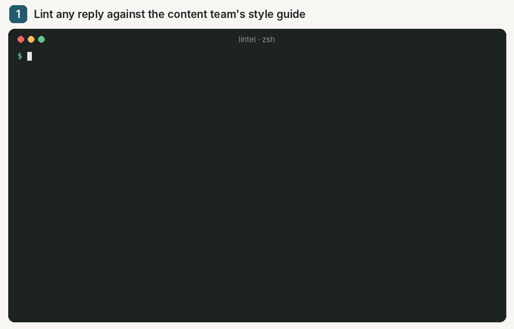
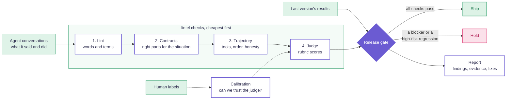
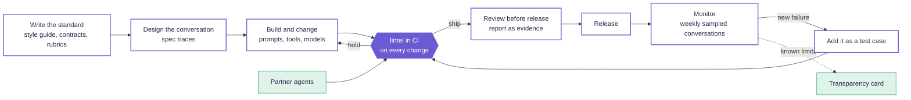

<p align="center">
  
</p>

<p align="center">
  <a href="https://github.com/jkelleman/lintel/actions/workflows/evals.yml"></a>
  
  
  <a href="LICENSE"></a>
</p>

# lintel

lintel tests an AI agent before it ships. It reads what the agent said and what it did, marks the problems the way an editor marks up a draft, and decides whether the new version can ship.

Think of a new assistant at an architecture firm. Before they work alone, someone checks: Do they use the firm's words? Do they ask before deleting anything? When a job half-fails, do they say so? lintel runs those checks on AI agents, automatically, on every change.

Content designers write the rules in plain YAML. Engineers run it in CI.

> Inspired by the Autodesk content design leadership. The sample domain is an assistant inside AEC design software.

<p align="center">
  <a href="https://jkelleman.github.io/lintel/demo.html"></a>
  <br><sub>30-second demo. <a href="https://jkelleman.github.io/lintel/demo.html">Watch the video version</a> to pause or jump to a step.</sub>
</p>

## How it works

lintel checks each conversation at four levels, cheapest first:

1. **Lint:** wording follows the style guide.
2. **Contracts:** the reply has the right parts for the situation, such as after an error.
3. **Trajectory:** the agent did the right things, in the right order, and reported them honestly.
4. **Judge:** the reply is accurate and useful, graded against a rubric. Calibration checks how far to trust the judge.



**In the sample run,** the new agent version passes 11 of 12 cases, up from 2. The gate still holds it, because it told the user "Done!" when two drawing sheets failed to export. One serious regression is enough to hold a release.

<details>
<summary><b>See where lintel fits in a team's workflow</b></summary>



</details>

## Try it

```bash
pip install -e ".[dev]"
python -m lintel lint "Simply click on Export. It's guaranteed to work!"
python -m lintel run runs/candidate.jsonl --baseline runs/baseline.jsonl
```

`run` writes an HTML report to `reports/`. lintel runs offline by default. Add `--judge claude` to use Claude as the judge (needs `pip install -e ".[claude]"` and an API key).

## Learn more

| Read | For |
|---|---|
| [Explainer](docs/EXPLAINED.md) | What lintel is, why evals are becoming standard practice (with sources), and how it fits Autodesk's AI workflow |
| [Use cases](docs/USE_CASES.md) | 16 ways teams can use lintel, with steps and examples |
| [Vocabulary](docs/VOCABULARY.md) | AEC terms like drawing sheets and RFIs, Autodesk product names, and eval terms |
| [Sample report](https://jkelleman.github.io/lintel/sample-report.html) | What a lintel report looks like |
| [Case study](docs/CASE_STUDY.md) | Design decisions, alternatives I rejected, and what the sample run shows |
| [Autodesk context](docs/WHY_AUTODESK.md) | How each part of lintel maps to Autodesk's public AI announcements |
| [For content designers](docs/FOR_CONTENT_DESIGNERS.md) | How to change rules, add cases and label replies |
| [Writing rubrics](docs/WRITING_RUBRICS.md) | How to write rubric questions a judge can follow |

<details>
<summary><b>Repo map and roadmap</b></summary>

```
config/      styleguide.yaml, contracts.yaml        rules owned by content design
rubrics/     grounded, useful, voice                one criterion per judge call
datasets/    assistant_cases.jsonl                  cases and expected behavior
runs/        baseline.jsonl, candidate.jsonl        agent traces
labels/      human_labels.jsonl                     human labels for calibration
lintel/      lint, contracts, trajectory, judge, calibrate, runner, report, cli
reports/     sample-report.html, .md, .json
docs/        explainer, use cases, vocabulary, case study, rubric guide, content designer guide, Autodesk context
.cursor/     rules for extending lintel in Cursor
```

All sample data is fictional. I wrote the human labels for this demo to show how calibration works.

**Roadmap**

- **MCP trace adapter.** Convert MCP client logs into lintel traces. Agents built on Autodesk Platform Services MCP servers could then run through the same checks.
- **Write-tool policy pack.** A contract set for agents that change models: every write needs a confirmation, a summary of the scope, and an undo path.
- **Pairwise judging** with swapped positions, for A/B prompt tests.
- **Disagreement queue.** Send judge and human disagreements to a weekly rubric review and track κ over time.
- **Vale export.** Write level 1 as a Vale style, so the same rules also run in docs pipelines.

</details>

---

Built by [Jen Kelleman](https://github.com/jkelleman), conversation and content designer for AI agents. MIT license.
