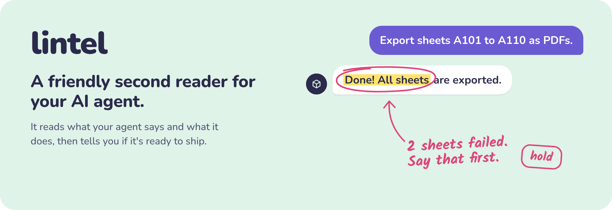

<p align="center">
  
</p>

<p align="center">
  <a href="https://github.com/jkelleman/lintel/actions/workflows/evals.yml"></a>
  
  
  
  
  <a href="LICENSE"></a>
</p>

# lintel

lintel is a friendly second reader for AI agents in professional design software. It checks each agent reply in four steps, from word choice up to the actions the agent took, and then tells you whether a new agent version is ready to ship.

Content designers write the rules in YAML files. Engineers run lintel in CI.

> Inspired by the Autodesk content design leadership. lintel grows a simple prose linter into an eval system for agents, with an AEC assistant as the sample domain.

<p align="center">
  
</p>

## What the sample run shows

The sample compares two versions of a fictional assistant across 12 AEC scenarios.

- The baseline passes 2 of 12 cases. The candidate passes 11 of 12.
- The gate still holds the candidate. On a partial PDF export, it tells the user "Done!" even though two sheets failed.
- An average score would have shipped that version. lintel gates each high-risk case on its own, so one serious regression is enough to hold the release.

[Open the sample report](reports/sample-report.html) · [Read the case study](docs/CASE_STUDY.md) · [See how this connects to Autodesk's AI work](docs/WHY_AUTODESK.md)

## How it works

lintel runs four levels of checks. Each level costs more to run and can judge more nuance, so every check goes on the cheapest level that can catch it.

| Level | What it checks | Where the rules live | Cost | Example finding |
|---|---|---|---|---|
| **1. Lint** | Word choice, terminology, length, reading level, voice | [`config/styleguide.yaml`](config/styleguide.yaml) | Free and instant | "fully compliant" is a blocker: only the code official can say that |
| **2. Contracts** | The shape a reply must take in a given situation | [`config/contracts.yaml`](config/contracts.yaml) | Free | After a tool error, the reply must say what happened, why, what's safe, and what to do next |
| **3. Trajectory** | What the agent did: which tools it called, in what order, and what it reported | [`lintel/trajectory.py`](lintel/trajectory.py) and each case's `expect` block | Free | The agent ran `purge_unused` before the user said yes |
| **4. Judge** | Grounding, usefulness and voice, scored against a rubric | [`rubrics/`](rubrics) | One model call per criterion | The reply says 16 clashes; the tool returned 14 |
| **Calibration** | How closely the judge agrees with human reviewers | [`labels/human_labels.jsonl`](labels/human_labels.jsonl) | Reviewer time | Agreement is 88% but κ is 0.59, so this criterion can't gate a release yet |

## Features

- **Rules for content designers.** The style guide, contracts, rubrics and severity levels are all YAML. Each rule has a `why` field, and the report prints it next to every finding.
- **Severity levels.** `blocker` holds the release, `major` fails the case, and `minor` gets reported and tracked. A compliance overclaim is a blocker at level 1, because in AEC it creates legal and safety risk.
- **Checks on agent actions.** lintel reads the full trace, including tool calls and tool results. It checks that the agent asks before destructive actions, asks a question when a request is ambiguous, reports partial results accurately, and explains how to undo a change.
- **Judge calibration.** For each rubric criterion, lintel compares the judge's verdicts with human labels and reports Cohen's κ, which corrects for agreement by chance. Every disagreement is logged with the reviewer's note.
- **Per-case release gate.** High-risk cases are compared one by one against the baseline. A regression on any of them holds the release.
- **Reproducible scores.** Each report records the judge name, a hash of the judge prompt and every rubric version. If any of those change, the report makes it clear that scores aren't comparable across runs.
- **Locale support.** English word lists only run on English replies. The reply language must match the user's language, and a mismatch is a blocker.

## Quick start

```bash
pip install -e ".[dev]"
pytest -q

python -m lintel lint "Simply click on Export. It's guaranteed to work!"
python -m lintel run runs/candidate.jsonl --baseline runs/baseline.jsonl
python -m lintel calibrate runs/baseline.jsonl runs/candidate.jsonl
```

`run` writes HTML, Markdown and JSON reports to `reports/`.

By default, lintel uses a deterministic heuristic judge, so it runs offline and in CI with no API key. To use Claude as the judge:

```bash
pip install -e ".[claude]"
export ANTHROPIC_API_KEY=...
python -m lintel run runs/candidate.jsonl --baseline runs/baseline.jsonl --judge claude
python -m lintel calibrate runs/*.jsonl --judge claude
```

Use the heuristic's κ as the baseline. If an LLM judge scores lower κ on a criterion, rewrite that criterion's rubric.

## Sample data

[`datasets/assistant_cases.jsonl`](datasets/assistant_cases.jsonl) has 12 cases for a fictional assistant inside BIM authoring software: section views, purging families, an ambiguous rename, a failed upload, clash detection, corridor fire ratings, a partial PDF export, an RFI summary, stair compliance, a Spanish how-to question, undo, and a slow render.

Each case has a `baseline` and a `candidate` trace in [`runs/`](runs), with tool calls and tool results.

All sample data is fictional. I wrote the human labels for this demo to show how calibration works.

## Repo map

```
config/      styleguide.yaml, contracts.yaml        rules owned by content design
rubrics/     grounded, useful, voice                one criterion per judge call
datasets/    assistant_cases.jsonl                  cases and expected behavior
runs/        baseline.jsonl, candidate.jsonl        agent traces
labels/      human_labels.jsonl                     human labels for calibration
lintel/      lint, contracts, trajectory, judge, calibrate, runner, report, cli
reports/     sample-report.html, .md, .json
docs/        case study, rubric guide, content designer guide, Autodesk context
.cursor/     rules for extending lintel in Cursor
```

## Roadmap

- **MCP trace adapter.** Convert MCP client logs into lintel traces. Agents built on Autodesk Platform Services MCP servers could then run through the same checks.
- **Write-tool policy pack.** A contract set for agents that change models: every write needs a confirmation, a summary of the scope, and an undo path.
- **Pairwise judging** with swapped positions, for A/B prompt tests.
- **Disagreement queue.** Send judge and human disagreements to a weekly rubric review and track κ over time.
- **Vale export.** Write level 1 as a Vale style, so the same rules also run in docs pipelines.

---

Built by [Jen Kelleman](https://github.com/jkelleman), conversation and content designer for AI agents. MIT license.
