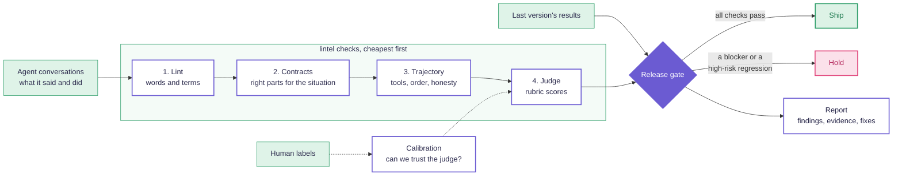
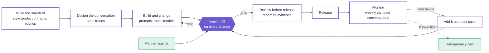

# lintel, explained

This page explains what lintel is, why testing AI agents this way is becoming standard practice, and how lintel could fit into Autodesk's AI workflow. Sources are linked throughout and collected at the end.

New to AEC or Autodesk terms? See the [vocabulary](VOCABULARY.md).

**On this page**

1. [The short version](#1-the-short-version)
2. [What lintel is](#2-what-lintel-is)
3. [Evals are becoming standard practice](#3-evals-are-becoming-standard-practice)
4. [How lintel lines up with published guidance](#4-how-lintel-lines-up-with-published-guidance)
5. [How lintel fits Autodesk's AI workflow](#5-how-lintel-fits-autodesks-ai-workflow)
6. [A 90-day pilot](#6-a-90-day-pilot)
7. [Limits and open questions](#7-limits-and-open-questions)
8. [Sources](#8-sources)

---

## 1. The short version

Picture a new assistant at an architecture firm who answers clients' questions and does small jobs in their drawings. Before you let that assistant work alone, you'd want someone to check their work. Do they use the firm's words? Do they ask before throwing anything away? When a job half-fails, do they say so?

lintel is that checker for AI assistants. It reads what the AI said and what it did, marks the problems the way an editor marks up a draft, and tells you whether the assistant is ready to work with real customers.

---

## 2. What lintel is

### The problem it solves

An AI agent is an assistant that can take actions: call tools, change files, run jobs. Testing agents is harder than testing regular software for two reasons.

- **The same input can produce different output.** Regular software tests check for one right answer. An agent can phrase things differently each time, so its tests need graders that can judge meaning.
- **Agents work in several steps.** An agent might look something up, ask the user a question, run a tool, and then report back. A mistake can happen at any step, and a polished final message can hide a bad action earlier in the conversation.

An **eval** (short for evaluation) is a repeatable test for an AI system. You give it a set of situations, run the agent on each one, and grade the results with clear rules.

### How lintel grades

lintel checks every conversation at four levels. Cheaper, more predictable checks run first.

| Level | Question it answers | How it grades | Example |
|---|---|---|---|
| 1. Lint | Does the wording follow the style guide? | Word lists and counts in YAML | "fully compliant" is flagged as a blocker |
| 2. Contracts | Does the reply have the parts this situation needs? | Required parts per situation | After an error: what happened, why, what's safe, what to do next |
| 3. Trajectory | Did the agent do the right things, in the right order? | Rules on tool calls and results | It must ask before purging families |
| 4. Judge | Is the reply accurate, useful and in the right voice? | A rubric, graded by a script or an LLM | Every number in the reply appears in the tool results |

Then **calibration** compares the judge's grades with grades from people, and reports Cohen's κ (kappa). κ measures agreement after removing the agreement you'd get by chance. A judge only gates a release on criteria where κ is 0.60 or higher.

Finally, the **release gate** compares the new agent version with the current one and decides whether it can ship. It checks each high-risk case on its own, so one serious regression is enough to hold a release, even when the average score goes up.

### Who owns what

Content designers own the rules: the style guide, the contracts, the rubric questions and the severity of each rule. They're all plain YAML files, and each rule includes a `why` that appears in the report next to every finding. Engineers own running lintel in CI and connecting it to the agent's logs.

---

## 3. Evals are becoming standard practice

In the past two years, testing AI systems with evals has moved from a research habit to an expectation across AI labs, analysts and standards bodies.

### AI labs publish eval playbooks

**Anthropic** describes three kinds of graders: code-based graders are fast, cheap and reproducible; model-based graders handle nuance but need calibration with people; human graders are the gold standard but slow. Its advice is to use code where you can, models where you need them, and people sparingly. It separates capability evals, which measure what an agent can do, from regression evals, which should pass close to 100% of the time. It also recommends starting with 20 to 50 tasks drawn from real failures, turning user-reported bugs into test cases, and running evals in CI whenever the agent or the model changes. ([Anthropic, "Demystifying evals for AI agents"](https://anthropic.com/engineering/demystifying-evals-for-ai-agents))

**OpenAI** recommends a similar loop: define the objective, collect a dataset that covers typical, edge and adversarial cases, choose metrics, compare runs, and evaluate continuously on every change. It advises checking an LLM judge against human labels before relying on it, controlling for judges' preference for longer answers, and having the judge reason before scoring. For agents, it adds checks on whether the agent picks the right tool and passes the right arguments. ([OpenAI, "Evaluation best practices"](https://developers.openai.com/api/docs/guides/evaluation-best-practices))

### Research backs the methods

- **LLM-as-judge.** A widely cited NeurIPS 2023 paper found that strong LLM judges agreed with human preferences more than 80% of the time, about as often as humans agree with each other. The same paper documented position bias, verbosity bias and self-enhancement bias, which is why calibration and careful prompt design matter. ([Zheng et al., "Judging LLM-as-a-Judge with MT-Bench and Chatbot Arena"](https://arxiv.org/abs/2306.05685))
- **Agent reliability.** τ-bench (ICLR 2025) tests agents that talk with a simulated user, use tools and follow domain policies. Even state-of-the-art function-calling agents succeeded on fewer than 50% of tasks, and they were inconsistent: the chance of passing the same task in all of 8 tries was under 25%. Its authors introduced the pass^k metric to measure that consistency. ([Yao et al., τ-bench](https://arxiv.org/abs/2406.12045))

### Analysts name it as its own category

In February 2026, Gartner published its first Market Guide for AI Evaluation and Observability Platforms. It advises software engineering leaders to invest in platforms that bring rigor and repeatability to testing business-critical AI applications. ([Gartner](https://www.gartner.com/en/documents/7387730)) Vendors summarizing the report cite a Gartner projection that 60% of software engineering teams will use AI evaluation platforms by 2028. ([Comet's summary, via Plushcap](https://www.plushcap.com/content/comet/blog/comet-comet-recognized-in-2026-gartner-market-guide-for-ai-evaluation-and-observability-platforms))

### Standards and regulation expect evidence

- **NIST.** The NIST AI Risk Management Framework organizes AI risk work into Govern, Map, Measure and Manage. Its Generative AI Profile, NIST AI 600-1 (July 2024), names 12 risks specific to generative AI, and pre-deployment testing is one of its four main focus areas. ([NIST AI 600-1](https://doi.org/10.6028/NIST.AI.600-1), [summary by Anaconda](https://www.anaconda.com/blog/nist-ai-600-1-generative-ai-profile-guide))
- **ISO/IEC 42001.** Published in December 2023, it's the first certifiable management system standard for AI. Clause 9 requires ongoing monitoring, measurement and evaluation. ([DQS overview](https://www.dqsglobal.com/en/explore/dqs-knowledge-center/iso-42001-explained), [Scrut glossary](https://www.scrut.io/glossary/performance-evaluation-iso-42001))
- **EU AI Act.** Article 15 requires high-risk AI systems to reach an appropriate level of accuracy, robustness and cybersecurity, and to perform consistently throughout their lifecycle. ([Article 15 text](https://artificialintelligenceact.eu/article/15/)) A design assistant may not fall under the Act's high-risk categories, but the article shows where expectations for documented, ongoing testing are heading.

### Docs teams already lint prose in CI

Teams that write docs as code use Vale, a prose linter that keeps style rules as YAML in the repo and enforces them in the editor and in CI. Packaged styles cover the Google, Microsoft and Red Hat style guides. ([Thoughtworks Technology Radar](https://www.thoughtworks.com/radar/tools/vale)) lintel's level 1 uses the same idea for agent replies.

---

## 4. How lintel lines up with published guidance

| Published recommendation | Source | Where it lives in lintel |
|---|---|---|
| Use code-based graders where possible, models where needed, people sparingly | Anthropic | Levels 1–3 are code; level 4 is a rubric judge; calibration uses human labels |
| Calibrate LLM judges against human experts | Anthropic, OpenAI | `lintel calibrate`, with Cohen's κ per criterion and logged disagreements |
| Grade each dimension separately; allow an "unknown" verdict | Anthropic | One criterion per judge call; every criterion defines when it's N/A |
| Have the judge reason before scoring; control for length bias | OpenAI, Zheng et al. | The judge prompt asks for evidence, then reasoning, then a verdict, and says length isn't evidence |
| Keep regression suites near 100% and run them on every change | Anthropic, OpenAI | Release gate in CI; high-risk cases gated one by one against the baseline |
| Turn real failures into test cases | Anthropic | [Use case 3](USE_CASES.md#3-turn-an-incident-into-a-permanent-test): incidents become permanent cases |
| Check tool selection as well as the final answer | OpenAI | Level 3: `must_call`, `must_not_call`, `confirm_before` |
| Measure consistency across repeated runs | τ-bench | Run each case several times and compare trace files (see [use case 1](USE_CASES.md#1-gate-a-prompt-or-system-prompt-change)) |
| Keep records that show testing is ongoing | NIST AI 600-1, ISO/IEC 42001 | Every report stores the judge, prompt hash, rubric versions and results as JSON |

---

## 5. How lintel fits Autodesk's AI workflow

*This section is a proposal from outside Autodesk, based on what Autodesk has published. lintel has no affiliation with Autodesk.*

### What Autodesk has committed to

- **Reliability as a principle.** Autodesk's Trusted AI program rests on five principles: responsibility, transparency, reliability, safety and security, and accountability. ([Autodesk News, "Trusted AI: Explained," Aug 2026](https://adsknews.autodesk.com/en/stories/how-autodesk-builds-trusted-ai/))
- **Assessment before release.** Autodesk says its AI development platform is certified to ISO/IEC 42001, and that cross-functional teams from engineering, security, privacy, legal, compliance and product assess each new AI capability, including its model performance, before it reaches customers. It also describes continuous monitoring after launch. (same source)
- **Testing for consistency and accuracy.** The same article says Autodesk's own models are tested for security, consistency and accuracy. (same source)
- **Human oversight.** Autodesk describes Autodesk Assistant as designed to support professional judgment, with controls and human oversight, and publishes AI Transparency Cards that list each feature's safeguards and known limitations. ([AU 2026 press release](https://kyodonewsprwire.jp/release/202609165978), [AI Transparency Cards](https://www.autodesk.com/trust/trusted-ai/ai-transparency-cards))
- **Agents that act, across many models and partners.** The next-generation Assistant previewed at AU 2026 can take action across workflows. An AI Orchestrator picks a model for each task, and Assistant Builder will let customers and partners connect their own agents. ([AU 2026 press release](https://kyodonewsprwire.jp/release/202609165978))
- **Write access on the way.** The Revit Public MCP Server is read-only today, with tools that change models planned for a separate write server. ([Autodesk AEC blog](https://www.autodesk.com/blogs/aec/2026/06/17/revit-public-mcp-server/))
- **An editorial standard.** Autodesk maintains a public Editorial Style Guide and asks writers to review AI output for accuracy and tone. ([Autodesk Editorial Style Guide](https://styleguide.autodesk.com/?p=7388), [Using Generative AI](https://styleguide.autodesk.com/using-generative-ai/))

### Why lintel belongs in that workflow

Those commitments describe an assistant that takes real actions in professional work and is held to a standard of reliability, human oversight and ongoing monitoring. lintel gives each of those commitments a repeatable test that runs on every change:

- **Reliability and consistency** become a release gate that compares each new version with the current one, case by case.
- **Human oversight** becomes a blocker-level check that the agent asks before destructive actions and explains how to undo them.
- **The editorial standard** becomes rules that check every assistant reply, owned by the content team that owns the guide.
- **Assessment before release** gets a report the cross-functional review can read, with the evidence behind each finding.
- **Continuous monitoring** gets a weekly check on sampled production conversations, with each new failure turned into a permanent test.

### Where it fits, step by step

| Stage | Who | What lintel does | What comes out |
|---|---|---|---|
| **Write the standard** | Content design, with the Editorial Style Council | Encode the parts of the style guide a script can check, plus contracts for errors, destructive actions and compliance questions | `styleguide.yaml`, `contracts.yaml`, owned by content design |
| **Design the conversation** | Conversation and product designers | Write the ideal conversation for key scenarios as traces, with expected behavior | Spec traces that double as tests ([use case 15](USE_CASES.md#15-write-conversation-specs-before-the-agent-exists)) |
| **Build and change** | Engineers | Run lintel in CI on every prompt, tool or model change | A ship or hold decision and an HTML report in each pull request |
| **Review before release** | The cross-functional assessment team | Read the report: findings by severity, regressions since the last version, and how far the judge can be trusted | Written evidence for the release decision and the management system records |
| **Describe limits honestly** | Trust and content teams | Use categories that still fail as input for a feature's known limitations | Clearer limitations on the AI Transparency Card |
| **Route models** | Platform teams running the AI Orchestrator | Compare candidate models on the same cases, by tag | Per-task evidence for which model handles which job ([use case 2](USE_CASES.md#2-compare-models-before-switching-or-routing)) |
| **Onboard partner agents** | Assistant Builder and Marketplace teams | Run partner agents on a shared case suite with the same rules | One written bar for every agent in the product ([use case 4](USE_CASES.md#4-review-a-partner-or-third-party-agent)) |
| **Prepare for write tools** | Teams building write servers and agent actions | Add a confirmation, scope summary and undo check for each write tool | Write actions that meet the human-oversight commitment |
| **Monitor after launch** | AI product owners and quality teams | Weekly checks on sampled conversations; new failures become cases | Trend lines by rule, and a test suite that grows from real use ([use case 16](USE_CASES.md#16-monitor-production-quality-over-time)) |

---

## 6. A 90-day pilot

A pilot on one Autodesk Assistant surface could look like this.

**Weeks 1–2: the standard.** Choose 20 to 30 style rules a script can check and write them into `styleguide.yaml`. Run them on a sample of real replies and tune the ones that fire too often.

**Weeks 3–4: situations.** Write contracts for the three or four situations that matter most on that surface, such as errors, destructive actions and compliance questions. Build 30 to 50 cases from real conversations and past incidents.

**Weeks 5–8: the judge.** Have two reviewers label the cases for the most important rubric criteria. Check their agreement with each other, then run calibration on the heuristic judge and an LLM judge. Gate only on criteria at κ 0.60 or higher.

**Weeks 9–12: the gate.** Add lintel to CI for prompt, tool and model changes on that surface. Attach the HTML report to every pull request, and start a weekly 30-minute review of judge and human disagreements.

**How to measure the pilot:**
- Regressions caught before release that would otherwise have reached customers
- Time content designers spend reviewing agent output, before and after
- κ for each gated criterion over time
- Share of incidents that become permanent cases within a week

---

## 7. Limits and open questions

- **Heuristic checks are simple by design.** Word lists and signal phrases catch missing pieces reliably but can't judge meaning. Use an LLM judge for accuracy and tone, and keep calibrating it.
- **The sample data is fictional.** The cases and labels show how lintel works. A real rollout needs real conversations, with personal data removed.
- **Trace export is the main integration task.** lintel reads a simple JSONL trace format. Connecting it to Autodesk's agent logs, or to MCP client logs, is the first engineering step, and an MCP adapter is on the roadmap.
- **Internal tools may already cover parts of this.** Autodesk likely has internal eval and monitoring systems. lintel's most useful pieces to bring in are the content-owned rules, the contracts and the per-case gate.

---

## 8. Sources

**AI labs and research**
- Anthropic. [Demystifying evals for AI agents](https://anthropic.com/engineering/demystifying-evals-for-ai-agents).
- OpenAI. [Evaluation best practices](https://developers.openai.com/api/docs/guides/evaluation-best-practices).
- Zheng, L. et al. (2023). [Judging LLM-as-a-Judge with MT-Bench and Chatbot Arena](https://arxiv.org/abs/2306.05685). NeurIPS 2023.
- Yao, S., Shinn, N., Razavi, P., Narasimhan, K. (2024). [τ-bench: A Benchmark for Tool-Agent-User Interaction in Real-World Domains](https://arxiv.org/abs/2406.12045). ICLR 2025.

**Analysts**
- Gartner (Feb 2026). [Market Guide for AI Evaluation and Observability Platforms](https://www.gartner.com/en/documents/7387730) (summary; full report for Gartner clients).

**Standards and regulation**
- NIST (July 2024). [AI 600-1, Generative AI Profile](https://doi.org/10.6028/NIST.AI.600-1).
- ISO/IEC 42001:2023, AI management system. [Overview from DQS](https://www.dqsglobal.com/en/explore/dqs-knowledge-center/iso-42001-explained).
- EU AI Act, [Article 15: Accuracy, robustness and cybersecurity](https://artificialintelligenceact.eu/article/15/).

**Prose linting**
- Thoughtworks Technology Radar. [Vale](https://www.thoughtworks.com/radar/tools/vale).

**Autodesk**
- Autodesk News (Aug 2026). [Trusted AI: Explained](https://adsknews.autodesk.com/en/stories/how-autodesk-builds-trusted-ai/).
- Autodesk (Sept 2026). [AU 2026 press release on agentic AI](https://kyodonewsprwire.jp/release/202609165978).
- Autodesk. [AI Transparency Cards](https://www.autodesk.com/trust/trusted-ai/ai-transparency-cards).
- Autodesk AEC blog (June 2026). [Introducing the Revit Public MCP Server](https://www.autodesk.com/blogs/aec/2026/06/17/revit-public-mcp-server/).
- Autodesk. [Editorial Style Guide](https://styleguide.autodesk.com/?p=7388) and [Using Generative AI](https://styleguide.autodesk.com/using-generative-ai/).

For the full mapping of lintel to Autodesk's public announcements, see [How lintel connects to Autodesk's AI work](WHY_AUTODESK.md).
